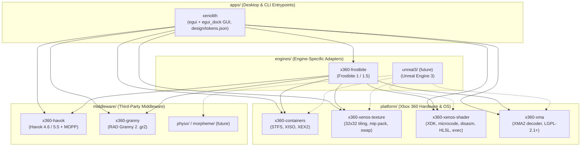
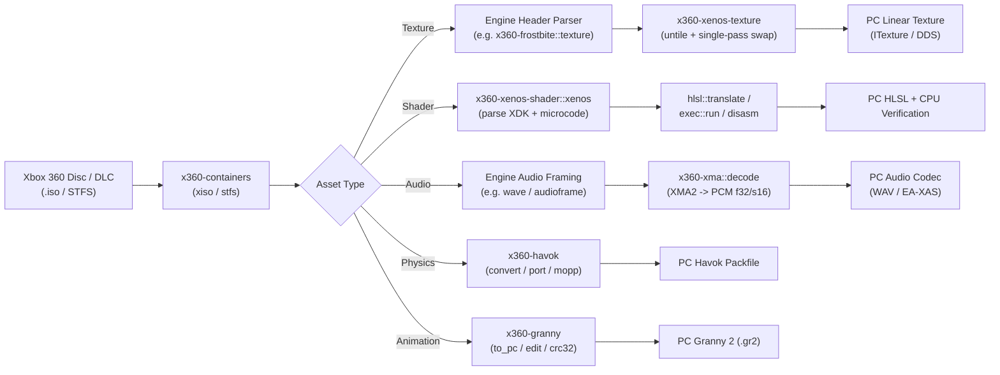

# Software Architecture & Design Specification

**Project:** `xb360-to-pc-porting-tools`  
**Language / Edition:** Rust 2024 (`rust-version = "1.100"`)  
**Architecture Style:** Layered Modular Monolith (Cargo Workspace)

---

## 1. Purpose & Scope

`xb360-to-pc-porting-tools` is a pure-Rust library suite for reading Xbox 360 media containers, decoding Xbox 360 hardware-specific formats (Xenos GPU textures, Xenos shaders, XMA2 audio), converting third-party middleware assets (Havok Physics, RAD Granny 2), and adapting those primitives to specific game engines (starting with Frostbite 1 / 1.5, and designed for side-by-side expansion to Unreal Engine 3, MT Framework, etc.).

### Non-Goals
* **No copyrighted game data or SDK headers** are stored in this repository. All tests operate on synthetic, self-contained binary inputs.
* **No runtime dynamic `.dll` plugin ABI.** Extensibility is achieved through Cargo workspace crates, trait boundaries, and compile-time feature flags.
* **No `unsafe` code** anywhere in the workspace (`unsafe_code = "deny"`).

---

## 2. Three-Tier Layered Architecture

The repository is divided into three strict horizontal layers. Dependencies flow **strictly downward**: an engine adapter may depend on middleware and platform crates; middleware may depend on platform crates; platform crates have zero knowledge of any middleware or game engine.

### Layer Responsibilities

| Layer | Directory | Responsibility | Coupling Rule |
|---|---|---|---|
| **Apps** | `apps/` | User-facing desktop GUI (`xenolith`, `bin/xenolith.exe`) and future CLI entrypoints. | Feature-gated over `engines/`, `middleware/`, and `platform/` (e.g. `default = ["frostbite", "xma"]`). |
| **Platform** | `platform/` | Xbox 360 hardware, OS, and GPU/audio formats (STFS, XISO, Xenos tiling, Xenos microcode, XMA2). | **Engine-agnostic & middleware-agnostic.** Operates on raw payloads and explicit descriptors (`SurfaceDesc`, `Shader`, `Riff`). |
| **Middleware** | `middleware/` | Third-party SDK binary formats shipped across many Xbox 360 titles (Havok Physics, RAD Granny 2). | **Engine-agnostic.** Parameterized by metadata (e.g., Havok `Classes` tables) rather than hardcoded game structs. |
| **Engines** | `engines/` | Engine-specific container headers, format-ID enums, vertex layouts, audio framing, and PE class extractors. | Owns all engine headers (e.g., Frostbite's 92-byte `XenonTexture`/`ITexture` header) and delegates heavy work to `platform/` and `middleware/`. |

### Optional Per-Layer Shared Cores
As sibling crates grow within any tier, each top-level folder may introduce a `core/` crate (`platform/core`, `middleware/core`, `engines/core`) to host shared byte/endian primitives, common IR traits, or cross-engine asset pipeline interfaces without blurring tier boundaries.

---

## 3. Data-Flow Pipeline

A typical Xbox 360 → PC asset conversion flows through the crates as follows:

---

## 4. Engineering Invariants & Quality Rules

Enforced workspace-wide in [Cargo.toml](../Cargo.toml):

1. **Memory Safety (`unsafe_code = "deny"`):** Zero `unsafe` blocks across the entire workspace. All binary reads are bounds-checked; malformed, truncated, or fuzzed inputs return typed `Result<T, E>` errors rather than panicking.
2. **Panic Hygiene (`unwrap_used`, `expect_used`, `panic`, `indexing_slicing` warned):** Production paths never panic on untrusted input. Property tests (`proptest`) verify arbitrary/truncated byte streams across texture untiling, Havok packfiles, XMA2 packets, and Xenos shaders.
3. **Determinism (`iter_over_hash_type = "warn"`):** Outputs must be byte-for-byte reproducible across runs and platforms. `BTreeMap` / sorted iteration is used wherever iteration order can reach an output; dependencies are exact-version pinned (`=x.y.z`).
4. **Zero-Copy / Single-Pass Hot Paths:**
   * `x360-xenos-texture::untile` performs 16-bit endian swapping on the fly during linear block copy (no full-payload `.to_vec()` clone).
   * `x360-xenos-shader::exec` uses a single flat register file (`num_regs * n`) and reusable scratch buffers for zero per-instruction heap allocations.
   * Batch APIs (`convert_all`, `translate_blobs`, `to_pc_all`, `encode_all`) parallelize over Rayon's work-stealing pool while preserving input order.
5. **Documentation Hygiene:** `missing_docs = "warn"` is enabled workspace-wide, and `RUSTDOCFLAGS="-D warnings" cargo doc --workspace --no-deps` must pass with zero warnings.

---

## 5. Licensing Architecture

The workspace is **MIT-licensed** (`LICENSE`), with one strictly isolated exception:

* **`platform/x360-xma`** is a Rust port of FFmpeg's WMA Pro / XMA2 decoder (`libavcodec/wmaprodec.c`) and is licensed under **LGPL-2.1-or-later** (`platform/x360-xma/LICENSE`).
* Keeping `x360-xma` as its own leaf crate ensures consumers who require a strictly MIT-only dependency graph can omit `x360-xma` without affecting any other crate.

---

## 6. Extension Playbook

### Adding a New Engine (e.g., `engines/unreal3`)
1. Create `engines/unreal3/Cargo.toml` and add `"engines/unreal3"` to `[workspace.members]` in root `Cargo.toml`.
2. Depend on the shared crates needed (`x360-containers`, `x360-xenos-texture`, `x360-xenos-shader`, `x360-xma`, etc.).
3. Implement Unreal's container/header wrappers (`UPK`, `Texture2D`, `FStaticMesh`, `USoundNodeWave`) inside `engines/unreal3/src/`, mapping Unreal texture formats into `x360_xenos_texture::SurfaceDesc` and calling `x360_xenos_texture::untile`.
4. Add synthetic unit & property tests inside `engines/unreal3/` with zero dependency on external game files.

### Adding a New Middleware (e.g., `middleware/physx` or `middleware/morpheme`)
1. Create `middleware/<name>/Cargo.toml` and register it in `[workspace.members]` and `[workspace.dependencies]`.
2. Keep the crate completely free of engine-specific wrappers; accept engine metadata (class tables, endianness flags, resource headers) via structs or traits.
