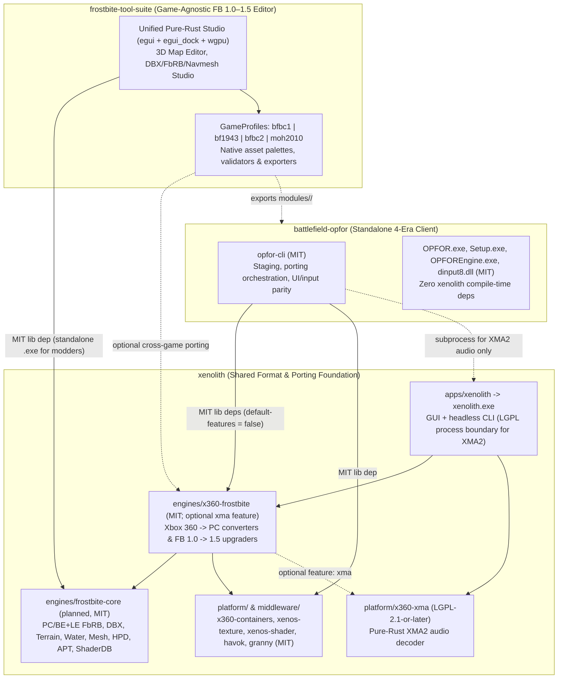

# Frostbite 1.0–1.5 Ecosystem & Tool Suite Roadmap

This document defines the target architecture across **Xenolith** (`xenolith`), **Battlefield OPFOR** (`battlefield-opfor`), and the planned **Frostbite Tool Suite** (`frostbite-tool-suite`, evolving from `bfbc2-tool-suite`, `bf1943-tool-suite`, and `project-opfor-moh` research).

---

## 1. Three-Repository Dependency Stack

Dependencies flow strictly downward with **zero circular references** and strict **MIT / LGPL-2.1 license isolation**:

---

## 2. End-User vs. Builder Dependencies

| Audience | What They Need | Notes |
|---|---|---|
| **Battlefield OPFOR End User** | `battlefield-opfor` release (`OPFOR.exe`, `Setup.exe`, `OPFOREngine.exe`, `dinput8.dll`, `utility/opfor-cli.exe`, `utility/xenolith.exe`) + own legal game files | **No `bfbc2-tool-suite`**, no Python, no .NET/C# runtime required. |
| **Battlefield OPFOR Source Builder** | `battlefield-opfor` + `xenolith` (for `utility/xenolith.exe` and MIT library crates) | Single pure-Rust toolchain (`cargo`). |
| **Frostbite Tool Suite End User (Modder)** | Single standalone `frostbite-tool-suite` binary + own legal copy of the target game (BFBC2, OPFOR, BF1943, BFBC1, or MoH 2010 MP) | **No Python, no C#, no separate `xenolith` install** required for native PC map/mod editing. |

---

## 3. Deduplicating `battlefield-opfor` and `xenolith`

### Phase 1: Prepare `xenolith` for MIT-Only Library Consumers
1. **Feature-gate `x360-xma` inside `x360-frostbite`**:
   - Move `x360-xma` behind `[features] default = ["xma"]` in `engines/frostbite/Cargo.toml` so downstream MIT crates (`opfor-cli`, `frostbite-tool-suite`) can depend on `x360-frostbite` with `default-features = false` without pulling LGPL-2.1 code.
2. **Extract `engines/frostbite-core` (optional, recommended for `frostbite-tool-suite`)**:
   - Host schema-agnostic, version-aware Frostbite 1.0–1.5 readers/writers (`fbrb`, `dbx`, `apt`, `terrain`, `water`, `meshdata`, `hpd`, `shader_db`) with **zero Xbox 360 hardware dependencies**.
   - Keep `x360-frostbite` focused on Xbox 360 → PC conversion and Frostbite 1.0 → 1.5 migration (`bfbc1/`, `bundle_port`, `menu_export`, `wavport`).

### Phase 2: Wire `opfor-cli` to `xenolith` MIT Crates
1. Add `x360-containers` and `x360-frostbite` (`default-features = false`, pinned git rev + local `[patch]` override) to `battlefield-opfor/crates/opfor-cli/Cargo.toml`.
2. Delete duplicated `FbRB`, `XISO`, and `STFS` parsers from `opfor-cli` (`bfbc1.rs`, `port.rs`). *(EA APT `BIGF` has already been deduplicated inside `battlefield-opfor` via `opfor-apt::bigf`.)*
3. Replace `%TEMP%` `dbx-to-xml` / `xml-to-dbx` subprocess roundtrips in `opfor-cli` with direct in-memory `x360_frostbite::dbx::DbxFile` AST manipulation.
4. Keep `utility/xenolith.exe` strictly as the LGPL-2.1 process boundary for XMA2 audio transcoding (`port-fbrb` with audio, `port-streaming-sounds`, `export-bf1943-menu`).
5. Keep `opfor-host`, `opfor-dll`, `opfor-launcher`, `opfor-setup`, and `opfor-vfs` free of `xenolith` dependencies so runtime builds stay fast and minimal.

---

## 4. Transforming `bfbc2-tool-suite` into `frostbite-tool-suite`

Instead of maintaining separate `bfbc2-tool-suite` and `bf1943-tool-suite` repositories (with mixed Python/C# tools and duplicated `core/` stacks), consolidate **BFBC1, BF1943, BFBC2/Vietnam/Onslaught, and Medal of Honor 2010 MP** findings into one pure-Rust, game-agnostic **`frostbite-tool-suite`**.

### Core Design: Schema-Agnostic Engine + Per-Game `GameProfile`s

`frostbite-core` remains strictly **schema-agnostic** (faithful binary read/write for every Frostbite 1.0–1.5 format without hardcoding BFBC2 class names). All game-specific knowledge lives in isolated `GameProfile` adapters:

| Profile | Engine Dialect | Native Capabilities |
|---|---|---|
| **`bfbc1`** | Frostbite 1.0 (Xbox 360 / PS3) | `0x29` heightfields, Kynogon HPD v1, Havok 4.6.1, Gold Rush & SP mission entities, `ske01` skeleton |
| **`bf1943`** | Frostbite 1.5 early (Xbox 360 / PS3 / PC) | `0x2D` heightfields, Air Raid / bunker / `ScorePartComponentData` classes, Pacific maps, BE/LE NavKit |
| **`bfbc2`** | Frostbite 1.5 (PC / Console) | `0x31` heightfields, Kynogon HPD v2, Havok 5.5.0, Rush/Conquest/Vietnam/Onslaught, stock BFBC2 & OPFOR `modules/` export |
| **`moh2010`** | Frostbite 1.5 MP (PC / Console) | MoH-native DBX schemas (Combat Mission, Sector Control, Objective Raid, Team Assault), MoH asset palette, native `mohmpgame.exe` level & mod export |

### What Each `GameProfile` Supplies
1. **Install & VFS Discovery**: Locates `Dist/`, `Package/`, `Output/`, `modules/`, and `package.mft` for the target game.
2. **Format Defaults**: Endianness (BE/LE), heightfield header length, HPD version, Havok SDK version.
3. **Native Asset Palette (Zero Cross-Game Leakage)**:
   - Indexes blueprints, static/dynamic models, vehicles, kits, effects, and textures directly from the user's own installation of the active target game (e.g., editing a **MoH 2010 MP** level exposes MoH's own `Dist/`/`Package/`/`mp_common` blueprints with genuine MoH partition/instance GUIDs—never BFBC2 assets).
4. **Entity Classification**: Maps game-specific DBX class names into editor layers (spawns, objectives, vehicles, destructibles, AI orders, cover/tactical annotations).
5. **Native Validator & Exporter**:
   - Validates DBX GUID references against the target game's own `mp_common` + level bundles before writing.
   - **Native Mode (`MoH → MoH`, `BFBC2 → BFBC2`, `OPFOR → OPFOR`)**: Reads and writes native `.fbrb`, `.dbx`, terrain, and `.hpd` bundles directly without cross-game schema rewrites—so modders can author and export **MoH-compatible levels using MoH's own assets** for `mohmpgame.exe`, stock BFBC2 mods, or `battlefield-opfor/modules/<mod>/` packages.
   - **Cross-Game Port Mode (`Game A → Game B`)**: Explicitly invokes `xenolith`'s migration pipeline only when the user chooses to port a level or asset to another Frostbite 1.5 title.

### Migration Sequence for `frostbite-tool-suite`
1. **Pure-Rust Studio Shell**: Single `eframe`/`egui` + `egui_dock` + `wgpu` binary sharing `xenolith/design/tokens.json`.
2. **In-Process Format Tools**: Replace C# `DbxEdit`/`FbrbTool` and Python `LevelDiff` with docked `frostbite-core` panels (FbRB browser/packer, DBX tree editor/differ, GUID reference checker).
3. **Unified 3D Map Editor & Navmesh Studio**: `wgpu` viewport rendering terrain, water, Havok collision, placed entities with transform gizmos + BVH picking, and Kynogon HPD overlays/editing.
4. **Clean-Room NavKit Integration**: Keep `bfbc2-auto-navkit` callable during transition, then port the voxel/sector/HPD generator into a pure-Rust `frostbite-navkit` crate to eliminate the final Python dependency.
